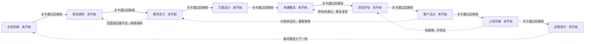
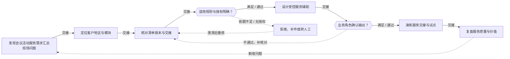
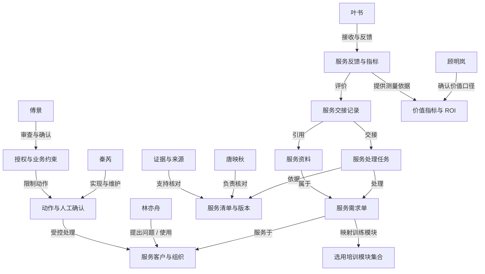

# 会议活动服务需求汇总 · 项目练习 1

## 当前实践模块

- 会议活动服务需求汇总（dlg-travel-conference）

## 项目可选模块

- 会议活动服务需求汇总（dlg-travel-conference）

## 模块已访谈证据（待核实）

尚未导入

# FDE 全流程训练记录

项目：会议活动服务需求汇总

训练者填写的任务和角色评审记录；不自动证明真实客户授权、生产上线或实际收益。

## 1. 业务挖掘

从经营目标、真实事件和指标基线中判断是否值得立项。

### 识别业务机会

交付：业务机会清单

状态：未开始 · 责任人：未填写

证据：未填写

尚无训练记录

### 建立现状基线

交付：指标基线与价值假设

状态：未开始 · 责任人：未填写

证据：未填写

尚无训练记录

### 确认立项与决策链

交付：项目章程与利益相关者地图

状态：未开始 · 责任人：未填写

证据：未填写

尚无训练记录

关卡：业务负责人确认问题、指标口径与调查范围

{"status":"待确认"}

## 2. 现场调研

还原实际流程，用多角色和多来源材料核实问题。

### 开展角色访谈

交付：访谈记录与角色地图

状态：未开始 · 责任人：未填写

证据：未填写

尚无训练记录

### 还原现状流程

交付：现状流程图与异常路径

状态：未开始 · 责任人：未填写

证据：未填写

尚无训练记录

### 四来源收敛与材料核对

交付：四来源收敛表、证据台账与问题清单

状态：未开始 · 责任人：未填写

证据：未填写

尚无训练记录

关卡：关键流程、异常、证据矛盾和待核实项已形成记录

{"status":"待确认"}

## 3. 需求定义

把调查发现收敛为有证据、可验收、可追责的需求。

### 确定优先问题

交付：问题优先级与机会判断

状态：未开始 · 责任人：未填写

证据：未填写

尚无训练记录

### 编写需求与边界

交付：需求规格与追溯矩阵

状态：未开始 · 责任人：未填写

证据：未填写

尚无训练记录

### 约定验收标准

交付：验收清单与需求确认记录

状态：未开始 · 责任人：未填写

证据：未填写

尚无训练记录

关卡：问题优先级、需求范围和可测验收条件均有确认记录

{"status":"待确认"}

## 4. 方案设计

以最小试点验证价值，设计数据、系统和人工控制。

### 选定最小试点

交付：试点方案与方案比较

状态：未开始 · 责任人：未填写

证据：未填写

尚无训练记录

### 设计数据和系统边界

交付：架构图、数据与权限矩阵

状态：未开始 · 责任人：未填写

证据：未填写

尚无训练记录

### 制定构建与评估计划

交付：构建计划、评估计划与风险表

状态：未开始 · 责任人：未填写

证据：未填写

尚无训练记录

关卡：试点边界、方案取舍、数据权限与实施计划已评审

{"status":"待确认"}

## 5. 构建集成

实现可运行的最小闭环，使规则、模型与人工责任可追溯。

### 落实数据与工具契约

交付：数据契约与集成记录

状态：未开始 · 责任人：未填写

证据：未填写

尚无训练记录

### 实现业务闭环

交付：原型代码与版本说明

状态：未开始 · 责任人：未填写

证据：未填写

尚无训练记录

### 实现异常与审计

交付：异常处理与审计样例

状态：未开始 · 责任人：未填写

证据：未填写

尚无训练记录

关卡：指定版本可复现运行，异常和人工交接路径完整

{"status":"待确认"}

## 6. 测试评估

证明行为与需求一致，区分模拟验证、真实模型验证与业务验收。

### 建立评估集合

交付：评估集与需求覆盖表

状态：未开始 · 责任人：未填写

证据：未填写

尚无训练记录

### 执行测试与重复评估

交付：测试报告与评估结果

状态：未开始 · 责任人：未填写

证据：未填写

尚无训练记录

### 修复并回归确认

交付：缺陷闭环与质量结论

状态：未开始 · 责任人：未填写

证据：未填写

尚无训练记录

关卡：评估范围、版本、失败项、修复复测与剩余风险可审查

{"status":"待确认"}

## 7. 客户试点

在受控范围中验证实际采用和业务收益。

### 准备受控试点

交付：试点执行计划

状态：未开始 · 责任人：未填写

证据：未填写

尚无训练记录

### 开展用户验收

交付：用户验收与反馈记录

状态：未开始 · 责任人：未填写

证据：未填写

尚无训练记录

### 核对价值与继续决定

交付：试点收益复核与决策纪要

状态：未开始 · 责任人：未填写

证据：未填写

尚无训练记录

关卡：试点对照、用户反馈、退出条件与扩大范围决定有记录

{"status":"待确认"}

## 8. 上线交接

把通过试点的版本交给具名负责人，明确上线和回退责任。

### 审查上线准备

交付：上线准备检查与三方评审

状态：未开始 · 责任人：未填写

证据：未填写

尚无训练记录

### 演练发布与回滚

交付：发布计划与回滚演练记录

状态：未开始 · 责任人：未填写

证据：未填写

尚无训练记录

### 完成运维和用户交接

交付：交接清单、运行手册与签收记录

状态：未开始 · 责任人：未填写

证据：未填写

尚无训练记录

关卡：业务、技术和风险角色的上线准备及交接决定有依据

{"status":"待确认"}

## 9. 运营迭代

持续观察价值、质量和成本，形成下一轮业务发现。

### 建立持续运营节奏

交付：30/60/90天运营计划

状态：未开始 · 责任人：未填写

证据：未填写

尚无训练记录

### 演练事件与变更管理

交付：事件复盘与变更记录

状态：未开始 · 责任人：未填写

证据：未填写

尚无训练记录

### 复盘并启动下一轮发现

交付：项目复盘、迭代清单与作品集

状态：未开始 · 责任人：未填写

证据：未填写

尚无训练记录

关卡：运营节奏、事件闭环、复盘及下一轮优先级已确认

{"status":"待确认"}

# FDE阶段成果与追溯

项目：会议活动服务需求汇总
练习：0d5aa980-9ad0-46fb-bdc7-9e65fab2745f

- 报告 REPORT-9001fdf0-d089-41f2-8dbb-50bb42f6a573 v2：上海靖达国际商务会展旅行有限公司 · 业务需求发现报告

## 业务挖掘 · draft

成果：ART-bdc62f73-d5d9-4072-81cc-1bba65b48be5 v1

输入：REPORT-9001fdf0-d089-41f2-8dbb-50bb42f6a573 v2

围绕会议活动服务需求汇总整理业务挖掘。以下为基于已保存输入的待完善草稿。

### 业务机会清单

上游输入：上海靖达国际商务会展旅行有限公司 · 业务需求发现报告 v2：基于已采集的36条事实与访谈材料，会议服务需求的核心矛盾集中在交接点的版本与责任口径、异常需求的人工复核卡点、以及只读数据集成下的口径一致性。业务负责人已明确试点边界（单批次、50项验收、四周两名骨干）与决策权分配，但多个执行层口径（交接责任转移时点、规则维护人、脏数据复核责任、人工队列值守与响应时限、留存期限）尚未核实，属于待验证假设而非既定规则。建议切入点优先选择“版本交接与责任清单”与“异常人工复核卡点”，因其同时满足价值（减少重复核对）与不可逆风险控制（防止错误传播、越权对外承诺），且不依赖写回或外部接口。

本步整理：收集最近一次异常事件，区分客户提出的功能和真正要改善的业务结果。

待明确：哪个具体事件触发了需求？如果维持现状，会产生什么损失？
边界：合成业务场景；仅使用本项目资料，保留权限、异常与人工确认，真实接口与业务验收需另行核实

引用：dlg-travel-conference-f23、dlg-travel-conference-f25、dlg-travel-conference-f20、dlg-travel-conference-f24、dlg-travel-conference-f34、dlg-travel-conference-f04、dlg-travel-conference-f44、dlg-travel-conference-f42、dlg-travel-conference-f40、dlg-travel-conference-f15、dlg-travel-conference-f13、dlg-travel-conference-f14、dlg-travel-conference-f31、dlg-travel-conference-f50、dlg-travel-conference-f53、dlg-travel-conference-f51、dlg-travel-conference-f55、dlg-travel-conference-f32、dlg-travel-conference-f33、dlg-travel-conference-f35、dlg-travel-conference-f30

### 指标基线与价值假设

上游输入：上海靖达国际商务会展旅行有限公司 · 业务需求发现报告 v2：基于已采集的36条事实与访谈材料，会议服务需求的核心矛盾集中在交接点的版本与责任口径、异常需求的人工复核卡点、以及只读数据集成下的口径一致性。业务负责人已明确试点边界（单批次、50项验收、四周两名骨干）与决策权分配，但多个执行层口径（交接责任转移时点、规则维护人、脏数据复核责任、人工队列值守与响应时限、留存期限）尚未核实，属于待验证假设而非既定规则。建议切入点优先选择“版本交接与责任清单”与“异常人工复核卡点”，因其同时满足价值（减少重复核对）与不可逆风险控制（防止错误传播、越权对外承诺），且不依赖写回或外部接口。

本步整理：定义指标分子、分母、时间窗、样本来源和测量责任人，缺失数据列为待采集。

待明确：现状耗时、返工和错误如何计算？哪些数字还只是估计？
边界：合成业务场景；仅使用本项目资料，保留权限、异常与人工确认，真实接口与业务验收需另行核实

引用：dlg-travel-conference-f23、dlg-travel-conference-f25、dlg-travel-conference-f20、dlg-travel-conference-f24、dlg-travel-conference-f34、dlg-travel-conference-f04、dlg-travel-conference-f44、dlg-travel-conference-f42、dlg-travel-conference-f40、dlg-travel-conference-f15、dlg-travel-conference-f13、dlg-travel-conference-f14、dlg-travel-conference-f31、dlg-travel-conference-f50、dlg-travel-conference-f53、dlg-travel-conference-f51、dlg-travel-conference-f55、dlg-travel-conference-f32、dlg-travel-conference-f33、dlg-travel-conference-f35、dlg-travel-conference-f30

### 项目章程与利益相关者地图

上游输入：上海靖达国际商务会展旅行有限公司 · 业务需求发现报告 v2：基于已采集的36条事实与访谈材料，会议服务需求的核心矛盾集中在交接点的版本与责任口径、异常需求的人工复核卡点、以及只读数据集成下的口径一致性。业务负责人已明确试点边界（单批次、50项验收、四周两名骨干）与决策权分配，但多个执行层口径（交接责任转移时点、规则维护人、脏数据复核责任、人工队列值守与响应时限、留存期限）尚未核实，属于待验证假设而非既定规则。建议切入点优先选择“版本交接与责任清单”与“异常人工复核卡点”，因其同时满足价值（减少重复核对）与不可逆风险控制（防止错误传播、越权对外承诺），且不依赖写回或外部接口。

本步整理：明确业务发起人、使用者、出资者、审批者，记录访谈授权与调查边界。

待明确：谁承担结果？谁批准范围、数据访问及继续或停止？
边界：合成业务场景；仅使用本项目资料，保留权限、异常与人工确认，真实接口与业务验收需另行核实

引用：dlg-travel-conference-f23、dlg-travel-conference-f25、dlg-travel-conference-f20、dlg-travel-conference-f24、dlg-travel-conference-f34、dlg-travel-conference-f04、dlg-travel-conference-f44、dlg-travel-conference-f42、dlg-travel-conference-f40、dlg-travel-conference-f15、dlg-travel-conference-f13、dlg-travel-conference-f14、dlg-travel-conference-f31、dlg-travel-conference-f50、dlg-travel-conference-f53、dlg-travel-conference-f51、dlg-travel-conference-f55、dlg-travel-conference-f32、dlg-travel-conference-f33、dlg-travel-conference-f35、dlg-travel-conference-f30

需求：
- REQ-1 交接责任转移时点需以“接收方确认三项要素”为口径；负责人项目流程协调员（唐映秋）与业务负责人（顾明岚）共同确认；验收用3个虚构交接样本做桌面推演，分别按“发出即转移”和“接收确认后转移”两种口径生成责任清单，请顾明岚、林亦舟各判一次；以双方一致口径作为责任清单字段的验收前提，人工确认点设在顾明岚签字。；依据dlg-travel-conference-f23、dlg-travel-conference-f25、dlg-travel-conference-f20
- REQ-2 有效版本判定规则需明确维护人与复核周期；负责人审核与质量负责人（傅景）与业务负责人（顾明岚）；验收请傅景出具规则变更的审批与复核建议，顾明岚确认；以“规则变更后责任清单同步更新”作为试点验收的附加检查项，人工确认点为傅景的质量验收签字。；依据dlg-travel-conference-f24、dlg-travel-conference-f34、dlg-travel-conference-f04
- REQ-3 异常需求人工复核卡点需定义值守人、响应时限与暂停恢复条件；负责人审核与质量负责人（傅景）牵头，业务负责人（顾明岚）批准暂停；验收以模拟异常（主持人临时改用双语，f11）走一遍人工队列，记录从发现到复核完成的步骤与耗时；请傅景提出响应时限建议、顾明岚确认，人工确认点为傅景判定该异常是否闭环。；依据dlg-travel-conference-f44、dlg-travel-conference-f42、dlg-travel-conference-f40
- REQ-4 一线需要“缺项清单+来源位置”而非泛化摘要；负责人一线服务专员（林亦舟）提出，数字化工程师（秦芮）评估可行性；验收用脱敏只读导出（f32）生成一版缺项清单原型，字段限于演练编号、需求类别、责任人、时间窗、确认状态；请林亦舟在模拟70项样本上试用并记录误报漏报，人工确认点为林亦舟确认清单可用、秦芮确认字段来源可追溯。；依据dlg-travel-conference-f15、dlg-travel-conference-f13、dlg-travel-conference-f14、dlg-travel-conference-f31
- REQ-5 跨团队口径以原始记录为准，需先对齐主办方与执行团队目标；负责人客户协同代表（叶书）召集，项目流程协调员（唐映秋）提供原始记录；验收组织一次双方各出1名代表的模拟口径对齐会，用同一批虚构需求核对数量与状态；请叶书提出复盘召集与频率建议，人工确认点为双方代表书面确认口径一致。；依据dlg-travel-conference-f50、dlg-travel-conference-f53、dlg-travel-conference-f51、dlg-travel-conference-f55
- REQ-6 只读集成下的数据质量与故障兜底需明确复核责任与快照期限；负责人数字化工程师（秦芮）与审核与质量负责人（傅景）；验收在演练环境构造重复编号、空时间、版本断链各1例，走标记—挂接—人工复核流程；请秦芮提出快照期限建议、傅景确认复核责任，人工确认点为傅景确认脏数据处理留痕合规。；依据dlg-travel-conference-f32、dlg-travel-conference-f33、dlg-travel-conference-f35、dlg-travel-conference-f30

遗留项：书面Brief、行业可行性与现场测量是否已经核对？；本阶段责任人应补齐具体决定、执行证据与未解决事项。

确认：{"status":"待确认"}

## 现场调研 · missing

待生成；输入不足时先返回上游补齐。

## 需求定义 · missing

待生成；输入不足时先返回上游补齐。

## 方案设计 · missing

待生成；输入不足时先返回上游补齐。

## 构建集成 · missing

待生成；输入不足时先返回上游补齐。

## 测试评估 · missing

待生成；输入不足时先返回上游补齐。

## 客户试点 · missing

待生成；输入不足时先返回上游补齐。

## 上线交接 · missing

待生成；输入不足时先返回上游补齐。

## 运营迭代 · missing

待生成；输入不足时先返回上游补齐。

## 需求如何归纳

先从已采集事实形成问题假设，再约定业务结果、范围、失败控制和验收。缺少的来源标记待补，不能把六人访谈完整率当作四来源收敛或需求确认。

### 业务流程拆解

要回答：问题发生在哪一步，为什么要这样划分智能体？

1. 先画人工现状泳道，写出触发、输入、8–15个处理步骤、交接和异常。
2. 区分判断点与执行点；按使用的数据、权限、模型能力与失败方式组合执行步骤。
3. 在不可逆动作前设置确定性校验；为低置信、缺资料、冲突和越权安排具名人工接收人。

交付链：现状流程 → 失败方式 → 智能体/工具边界 → 校验与人工升级路径

原文：frameworks/workflow-decomposition.md

### 业务结果与不可逆风险矩阵

要回答：多个需求中，先做哪个最小可验证方案？

1. 列出3–5个候选切入点，分别说明改善的业务结果、现状基线和投入。
2. 评估失败何时被谁看见、能否在损害前拦截、是否可以撤销；不要把模型置信度等同于业务风险。
3. 优先选择高价值、可拦截且可恢复的切入点；高风险需硬约束和责任人否决权，价值或风险未知先补证据。

交付链：候选方案 → 价值/风险比较 → 选择与暂缓理由 → 验收指标与停止条件

原文：frameworks/outcome-risk-matrix.md

### 四来源收敛

要回答：谁说要做，哪里真的坏了，范围允许什么，技术是否可行？

1. Buyer：核实业务目标、预算、优先级和决定权；Operator：用最近一单还原真实操作和失败位置。
2. Brief：核对书面目标、范围、时间和排除项；Industry：寻找可比技术实践，并核实本项目的数据与接口差异。
3. 检查四个视角是否指向同一瓶颈。分歧保留在问题清单：一线帮助定位故障，决策者确认价值，Brief约束范围，行业证据帮助判断可行性。

交付链：四视角陈述与来源 → 收敛/分歧 → 待核实问题 → 有边界的需求假设

原文：frameworks/4-source-convergence.md

### 本次四来源核对

- Buyer · 业务决策者：顾明岚
  状态：已采集角色陈述，目标和预算仍待确认；已采集依据：dlg-travel-conference-f01、dlg-travel-conference-f00、dlg-travel-conference-f02、dlg-travel-conference-f03、dlg-travel-conference-f04、dlg-travel-conference-f05
- Brief · 书面需求：【演练假设】围绕会议服务需求，团队希望减少重复核对并提高服务可追溯性。请访谈不同角色，核实问题与可行的试点范围。
  状态：当前只有场景开场；书面Brief原文与版本待补；已采集依据：暂无
- Industry · 行业可行性：需要可比技术案例、数据条件和接口能力的核验材料。企业业务介绍不能证明技术可行。
  状态：待补行业实践与本项目适用性验证；已采集依据：暂无
- Operator · 一线使用者：林亦舟
  状态：已采集现场陈述，仍需样本与操作观察核实；已采集依据：dlg-travel-conference-f10、dlg-travel-conference-f11、dlg-travel-conference-f12、dlg-travel-conference-f13、dlg-travel-conference-f14、dlg-travel-conference-f15

### 从证据到候选需求

- REQ-1 交接责任转移时点需以“接收方确认三项要素”为口径
  依据：dlg-travel-conference-f23、dlg-travel-conference-f25、dlg-travel-conference-f20
  推导：事实要求交接须列明最新版本、未确认事项与截止时间（f23），且未确认项不能归到对方名下（f25）；但“确认即转移”目前是协调员自述的待验证假设，访谈中未获业务负责人或一线确认，责任清单字段设计直接受此影响。
  判断：候选需求；需用结果与不可逆风险矩阵比较，P0/P1/P2不等于已完成价值风险评分。
  下一步：用3个虚构交接样本做桌面推演，分别按“发出即转移”和“接收确认后转移”两种口径生成责任清单，请顾明岚、林亦舟各判一次；以双方一致口径作为责任清单字段的验收前提，人工确认点设在顾明岚签字。
- REQ-2 有效版本判定规则需明确维护人与复核周期
  依据：dlg-travel-conference-f24、dlg-travel-conference-f34、dlg-travel-conference-f04
  推导：版本有效期加确认状态双条件、作废保留原因已有口径（f24），过期来源不得覆盖已确认新版本（f34）；但谁有权修改规则、多久复核一次尚未核实，规则变动会使责任清单失效，属不可逆风险点。
  判断：候选需求；需用结果与不可逆风险矩阵比较，P0/P1/P2不等于已完成价值风险评分。
  下一步：请傅景出具规则变更的审批与复核建议，顾明岚确认；以“规则变更后责任清单同步更新”作为试点验收的附加检查项，人工确认点为傅景的质量验收签字。
- REQ-3 异常需求人工复核卡点需定义值守人、响应时限与暂停恢复条件
  依据：dlg-travel-conference-f44、dlg-travel-conference-f42、dlg-travel-conference-f40
  推导：无法确认版本或关键字段时须进人工队列、必要时暂停试点、不得默认通过（f44），且每条结果须关联来源与人工复核记录（f42）；但队列值守人、暂停批准与恢复条件尚未核实，直接影响验收能否成立。
  判断：候选需求；需用结果与不可逆风险矩阵比较，P0/P1/P2不等于已完成价值风险评分。
  下一步：以模拟异常（主持人临时改用双语，f11）走一遍人工队列，记录从发现到复核完成的步骤与耗时；请傅景提出响应时限建议、顾明岚确认，人工确认点为傅景判定该异常是否闭环。
- REQ-4 一线需要“缺项清单+来源位置”而非泛化摘要
  依据：dlg-travel-conference-f15、dlg-travel-conference-f13、dlg-travel-conference-f14、dlg-travel-conference-f31
  推导：一线明确要一页缺项清单和来源位置（f15），且习惯先群消息后补表、回填时间不等于发生时间（f13）；同时要求系统建议不覆盖原值（f14）。需求方向清晰，但清单字段与来源定位方式尚未与数据侧对齐。
  判断：候选需求；需用结果与不可逆风险矩阵比较，P0/P1/P2不等于已完成价值风险评分。
  下一步：用脱敏只读导出（f32）生成一版缺项清单原型，字段限于演练编号、需求类别、责任人、时间窗、确认状态；请林亦舟在模拟70项样本上试用并记录误报漏报，人工确认点为林亦舟确认清单可用、秦芮确认字段来源可追溯。
- REQ-5 跨团队口径以原始记录为准，需先对齐主办方与执行团队目标
  依据：dlg-travel-conference-f50、dlg-travel-conference-f53、dlg-travel-conference-f51、dlg-travel-conference-f55
  推导：冲突根源是主办方看议程效果、执行团队要可操作交付条件（f50），且数量、状态、截止时间须以原始记录核对而非比较汇总表（f53）；评估须同时看工时、返工与确认完整率（f51）。目标对齐方式与复盘召集人尚未核实。
  判断：候选需求；需用结果与不可逆风险矩阵比较，P0/P1/P2不等于已完成价值风险评分。
  下一步：组织一次双方各出1名代表的模拟口径对齐会，用同一批虚构需求核对数量与状态；请叶书提出复盘召集与频率建议，人工确认点为双方代表书面确认口径一致。
- REQ-6 只读集成下的数据质量与故障兜底需明确复核责任与快照期限
  依据：dlg-travel-conference-f32、dlg-travel-conference-f33、dlg-travel-conference-f35、dlg-travel-conference-f30
  推导：试点仅开放脱敏只读导出、不开放写回与外部接口（f32），脏数据须保留原行并交人工复核（f33），读取失败保留快照并标记时间（f35）；但脏数据复核责任归属、快照保留多久、由谁确认恢复尚未核实。
  判断：候选需求；需用结果与不可逆风险矩阵比较，P0/P1/P2不等于已完成价值风险评分。
  下一步：在演练环境构造重复编号、空时间、版本断链各1例，走标记—挂接—人工复核流程；请秦芮提出快照期限建议、傅景确认复核责任，人工确认点为傅景确认脏数据处理留痕合规。

## Demo执行证据

尚未执行绑定Demo评估。

## 阶段练习与训练评分

## 历史版本

保留1个旧版本。JSON导出包含原始报告、成果版本和完整输入引用。

# 会议活动服务需求汇总 · ROI测算

尚未保存ROI测算。

# 会议活动服务需求汇总 · FDE业务流程与Ontology

练习：项目练习 1

阶段进度与关卡来自本次练习；业务流程与对象关系为建模定义，不代表实际业务已经执行。

对象生命周期：服务任务：提出 → 待核实 → 待确认 → 已交接；未结项继续跟踪

选用模块：
- 会议活动服务需求汇总（dlg-travel-conference）

## FDE 项目处理流程

九阶段主线、阶段关卡和返工路径。完成与通过状态来自本次练习记录。

### 业务挖掘 · FDE阶段

从经营目标、真实事件和指标基线中判断是否值得立项。

关联阶段：业务挖掘

本次状态：未开始 · 0/3项任务

关卡：业务负责人确认问题、指标口径与调查范围

- 业务机会清单
- 指标基线与价值假设
- 项目章程与利益相关者地图

### 现场调研 · FDE阶段

还原实际流程，用多角色和多来源材料核实问题。

关联阶段：现场调研

本次状态：未开始 · 0/3项任务

关卡：关键流程、异常、证据矛盾和待核实项已形成记录

- 访谈记录与角色地图
- 现状流程图与异常路径
- 四来源收敛表、证据台账与问题清单

### 需求定义 · FDE阶段

把调查发现收敛为有证据、可验收、可追责的需求。

关联阶段：需求定义

本次状态：未开始 · 0/3项任务

关卡：问题优先级、需求范围和可测验收条件均有确认记录

- 问题优先级与机会判断
- 需求规格与追溯矩阵
- 验收清单与需求确认记录

### 方案设计 · FDE阶段

以最小试点验证价值，设计数据、系统和人工控制。

关联阶段：方案设计

本次状态：未开始 · 0/3项任务

关卡：试点边界、方案取舍、数据权限与实施计划已评审

- 试点方案与方案比较
- 架构图、数据与权限矩阵
- 构建计划、评估计划与风险表

### 构建集成 · FDE阶段

实现可运行的最小闭环，使规则、模型与人工责任可追溯。

关联阶段：构建集成

本次状态：未开始 · 0/3项任务

关卡：指定版本可复现运行，异常和人工交接路径完整

- 数据契约与集成记录
- 原型代码与版本说明
- 异常处理与审计样例

### 测试评估 · FDE阶段

证明行为与需求一致，区分模拟验证、真实模型验证与业务验收。

关联阶段：测试评估

本次状态：未开始 · 0/3项任务

关卡：评估范围、版本、失败项、修复复测与剩余风险可审查

- 评估集与需求覆盖表
- 测试报告与评估结果
- 缺陷闭环与质量结论

### 客户试点 · FDE阶段

在受控范围中验证实际采用和业务收益。

关联阶段：客户试点

本次状态：未开始 · 0/3项任务

关卡：试点对照、用户反馈、退出条件与扩大范围决定有记录

- 试点执行计划
- 用户验收与反馈记录
- 试点收益复核与决策纪要

### 上线交接 · FDE阶段

把通过试点的版本交给具名负责人，明确上线和回退责任。

关联阶段：上线交接

本次状态：未开始 · 0/3项任务

关卡：业务、技术和风险角色的上线准备及交接决定有依据

- 上线准备检查与三方评审
- 发布计划与回滚演练记录
- 交接清单、运行手册与签收记录

### 运营迭代 · FDE阶段

持续观察价值、质量和成本，形成下一轮业务发现。

关联阶段：运营迭代

本次状态：未开始 · 0/3项任务

关卡：运营节奏、事件闭环、复盘及下一轮优先级已确认

- 30/60/90天运营计划
- 事件复盘与变更记录
- 项目复盘、迭代清单与作品集

## 会议活动服务需求汇总 · 业务处理流程

合成案例的业务结构示意，作为访谈核对与方案设计的起点；节点不表示该步骤已经执行。

### 发现会议活动服务需求汇总现场问题 · 业务事件

从本项目中的一线事件提出具体困扰

关联阶段：业务挖掘

责任视角：林亦舟

- 角色提出的事件和问题

### 定位客户地区与模块 · 处理活动

限定本次演练对象和业务口径

关联阶段：现场调研

责任视角：唐映秋

- 输入、处理依据、输出和交接责任需要用项目证据核对

### 核对清单版本与交接 · 处理活动

用模块访谈、样本与规则核实问题

关联阶段：需求定义

责任视角：唐映秋

- 输入、处理依据、输出和交接责任需要用项目证据核对

### 适用规则与授权明确？ · 判断关卡

地区、版本或授权不明确时先澄清

关联阶段：方案设计

责任视角：傅景

- 输入、处理依据、输出和交接责任需要用项目证据核对

### 设计受控服务辅助 · 处理活动

围绕选定模块提交自己的方案和实现

关联阶段：构建集成

责任视角：秦芮

- 输入、处理依据、输出和交接责任需要用项目证据核对

### 业务角色确认输出？ · 判断关卡

逐项核对缺项、来源与人工控制

关联阶段：测试评估

责任视角：傅景

- 输入、处理依据、输出和交接责任需要用项目证据核对

### 演练服务交接与试点 · 处理活动

清楚区分已确认项与未结项

关联阶段：客户试点、上线交接

责任视角：叶书

- 输入、处理依据、输出和交接责任需要用项目证据核对

### 复盘服务质量与价值 · 业务事件

按模块复核时效、返工与ROI，进入下一轮

关联阶段：运营迭代

责任视角：顾明岚

- 反馈、运营指标和新需求

### 拒绝、补件或转人工 · 业务约束

按本项目核对资料、权限、版本与人工交接；不自动批准或写入业务系统

关联阶段：需求定义、测试评估

- 保留原因、来源和处理责任；问题澄清后重新核对

## 会议活动服务需求汇总 · Ontology 业务对象图

用“角色—对象—关系—动作—约束—价值”连接业务与实现。对象属性和生命周期是待证据核对的定义，不是生产系统实例。

### 顾明岚 · 参与角色

业务负责人：我关心业务价值、决策与试点范围。

关联阶段：业务挖掘、现场调研

- 业务负责人：我关心业务价值、决策与试点范围。

### 林亦舟 · 参与角色

一线服务专员：我可以讲具体经历、现场习惯和复核方式。

关联阶段：业务挖掘、现场调研

- 一线服务专员：我可以讲具体经历、现场习惯和复核方式。

### 唐映秋 · 参与角色

项目流程协调员：我熟悉流程、材料、交接与责任。

关联阶段：业务挖掘、现场调研

- 项目流程协调员：我熟悉流程、材料、交接与责任。

### 秦芮 · 参与角色

数字化工程师：我负责系统、数据、更新与故障处理。

关联阶段：业务挖掘、现场调研

- 数字化工程师：我负责系统、数据、更新与故障处理。

### 傅景 · 参与角色

审核与质量负责人：我关注风险、权限、留存和审计。

关联阶段：业务挖掘、现场调研

- 审核与质量负责人：我关注风险、权限、留存和审计。

### 叶书 · 参与角色

客户协同代表：我可以说明下游口径、投诉和反馈。

关联阶段：业务挖掘、现场调研

- 客户协同代表：我可以说明下游口径、投诉和反馈。

### 服务客户与组织 · 业务对象

客户/组织标识、服务地区、业务范围

关联阶段：现场调研、需求定义、方案设计

- 客户/组织标识
- 服务地区
- 业务范围

### 服务需求单 · 业务对象

需求ID、服务对象、地区、时间

关联阶段：现场调研、需求定义、方案设计

- 需求ID
- 服务对象
- 地区
- 时间

### 选用培训模块集合 · 业务对象

模块ID、业务线、训练范围

关联阶段：现场调研、需求定义、方案设计

- 模块ID
- 业务线
- 训练范围

### 服务清单与版本 · 业务对象

规则ID、适用地区、生效期、审定角色

关联阶段：现场调研、需求定义、方案设计

- 规则ID
- 适用地区
- 生效期
- 审定角色

### 服务处理任务 · 业务对象

任务ID、来源需求、责任角色、状态

关联阶段：构建集成、测试评估、客户试点、运营迭代

- 任务ID
- 来源需求
- 责任角色
- 状态

### 服务资料 · 业务对象

资料项、需求关联、版本、可见范围

关联阶段：构建集成、测试评估、客户试点、运营迭代

- 资料项
- 需求关联
- 版本
- 可见范围

### 服务交接记录 · 业务对象

交接对象、确认项、未结项、依据

关联阶段：构建集成、测试评估、客户试点、运营迭代

- 交接对象
- 确认项
- 未结项
- 依据

### 服务反馈与指标 · 业务对象

返工、时效、异常、测量口径

关联阶段：构建集成、测试评估、客户试点、运营迭代

- 返工
- 时效
- 异常
- 测量口径

### 动作与人工确认 · 受控动作

按权限调用工具、提交审核、记录决定；动作不能自行改变批准状态。

关联阶段：方案设计、构建集成、测试评估、上线交接

- 动作输入
- 责任角色
- 前置条件
- 副作用和审计

### 授权与业务约束 · 业务约束

按本项目核对资料、权限、版本与人工交接；不自动批准或写入业务系统

关联阶段：方案设计、构建集成、测试评估、上线交接

- 按本项目核对资料、权限、版本与人工交接；不自动批准或写入业务系统

### 证据与来源 · 证据来源

角色陈述、样本、制度、系统记录分别核对，未核实项保留状态。

关联阶段：方案设计、构建集成、测试评估、上线交接

- 来源ID
- 版本/时间
- 适用范围
- 核实状态

### 价值指标与 ROI · 价值指标

处理时长、返工次数、版本正确率、采用率与人工复核成本，需用本项目样本建立基线

关联阶段：业务挖掘、客户试点、运营迭代

- 业务量与时间基线
- 采用率与兑现率
- 建设/运行成本
- 测算依据

# FDE项目示范

尚未运行完整示范。