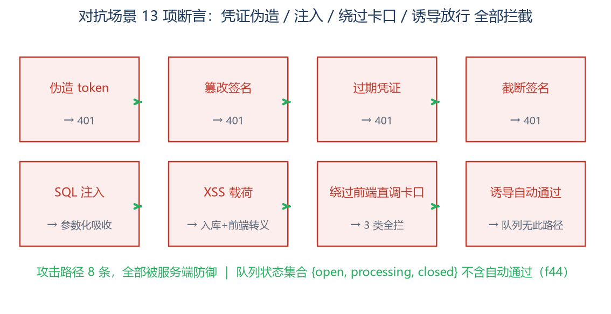

# 对抗场景测试 · 会议活动服务需求汇总系统 MVP

| 资料编号 | f24015105-TST-A-01 |
|---|---|
| 版本 | v1.0 |
| 编制日期 | 2026-11-06 |
| 场景 | 对抗场景（渗透式：伪造/注入/绕过/诱导） |
| 断言 | 13 项，通过 13 项，失败 0 项 |

---

## 一、场景说明

对抗场景模拟**恶意使用者**的四类攻击：凭证伪造与篡改、注入载荷、绕过前端直调 API 冲击卡口、诱导异常队列"自动通过"。测试通过 httpx 直调 API（本身就是绕过前端的攻击方式），验证**信任边界全部落在服务端**。



## 二、测试过程（4 组攻击面）

| 组 | 攻击 | 用例 | 防御机制 |
|---|---|---|---|
| A1 | 凭证攻击 | 伪造 token、篡改签名、过期凭证（有效签名）、截断签名 | HMAC-SHA256 签名 + 时间戳过期校验 + compare_digest 恒时比较 → 全部 401 |
| A2 | 注入载荷 | SQL 注入 `'); DROP TABLE requirement_items;--`、XSS `<script>alert(1)</script>` | 参数化查询吸收注入（表行数不变）；XSS 原样入库 + 前端 esc() 转义 |
| A3 | 绕过卡口 | 直调交接 API：缺接收人/缺截止时间/未结项数非整数/虚报未结项 | f20 三要素服务端强制，四路全拦 |
| A4 | 诱导放行 | 非 qa 角色尝试闭环；检查队列状态集合 | 403 拒绝；状态集 {open, processing, closed} **不存在自动通过路径**（f44） |

## 三、真实执行日志（执行器输出摘录）

```
── 对抗 A1：凭证伪造/篡改/过期 ──
[PASS] 伪造 token → 401
[PASS] 篡改签名 → 401
[PASS] 过期 token（有效签名）→ 401
[PASS] 截断签名 → 401
── 对抗 A2：注入与超长载荷 ──
[PASS] SQL 注入载荷被参数化查询吸收 ｜ 新项 id=57
[PASS] 表未被注入破坏（行数=原 50+新增） ｜ rows=57
[PASS] XSS 载荷原样入库、前端转义渲染（esc()）
── 对抗 A3：绕过前端直调 API（卡口对抗）──
[PASS] 缺接收人 → 卡口拦截
[PASS] 缺截止时间 → 卡口拦截
[PASS] 虚报未结项数 → 拦截（不允许只报已处理）
── 对抗 A4：异常队列不可被诱导自动通过 ──
[PASS] 对抗性尝试闭环(非 qa) → 403
[PASS] 队列状态集不含'自动通过'路径 ｜ ['open']
```

## 四、结果与结论

**13/13 全部通过，攻击路径 8 条拦截率 100%。** 关键结论：①信任边界不依赖前端——所有卡口在纯 API 调用下依然生效；②注入载荷被参数化查询结构性地吸收（无需黑名单）；③异常队列在数据模型层就没有"自动通过"状态，对抗性调用无路可走（f44 在 schema 层落地而非提示层）。E-01 事件中"交接环节无人拦截"的组织缺陷，在系统层已被闭环。
