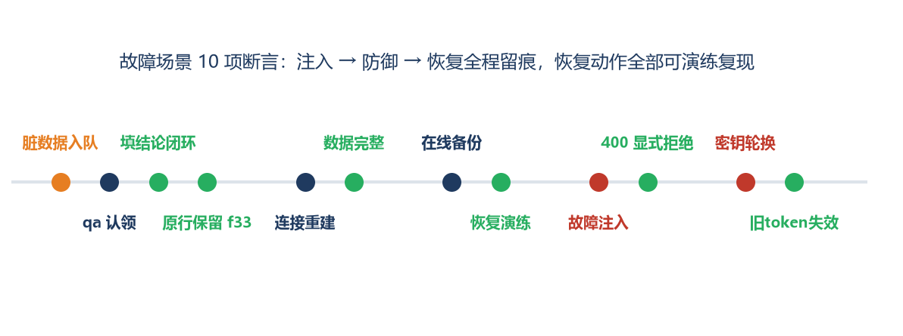

# 故障场景测试 · 会议活动服务需求汇总系统 MVP

| 资料编号 | f24015105-TST-F-01 |
|---|---|
| 版本 | v1.0 |
| 编制日期 | 2026-11-06 |
| 场景 | 故障场景（注入 + 恢复演练） |
| 断言 | 10 项，通过 10 项，失败 0 项 |

---

## 一、场景说明

故障场景验证系统在**异常条件与破坏性事件**下的韧性：脏数据工单闭环、进程重启后的数据持久性、备份→恢复演练、恶意输入注入、密钥轮换后的会话失效。



## 二、测试过程（5 组故障）

| 组 | 故障 | 验证 | 结果 |
|---|---|---|---|
| F1 | 脏数据工单 | 入队 open → qa 认领 → 填结论闭环；**原行保留未清洗（f33）** | 全流程闭环，原文"（群消息转发，原文缺失）"原样保留 |
| F2 | 进程重启 | 关闭连接后重建（模拟重启） | SQLite WAL 持久化，61 行数据完整 |
| F3 | 备份恢复 | `VACUUM INTO` 在线备份 → 独立恢复库 | 备份 61 行 = 在线 61 行 = 恢复 61 行 |
| F4 | 故障注入 | 非法 owner_id（'not-a-number'）、非法 version_id（'abc'）、不存在项 | 前两者显式 400（修复 D2/D3 后）、后者 404，无脏数据落库 |
| F5 | 密钥轮换 | 轮换 SECRET 后用旧 token 请求 | 旧凭证全失效 401（轮换=强制全员重登的安全机制） |

## 三、真实执行日志（执行器输出摘录）

```
── 故障 F1：异常工单全流程（脏数据不丢弃、人工闭环）──
[PASS] 脏数据项入队 open
[PASS] qa 填结论闭环
[PASS] 原行保留未清洗（f33） ｜ （群消息转发，原文缺失）
── 故障 F2：重启持久性（连接重建）──
[PASS] 重连后数据完整（SQLite WAL 持久化） ｜ rows=61
── 故障 F3：备份恢复 ──
[PASS] 在线备份行数一致 ｜ backup=61 live=61
[PASS] 恢复库行数一致 ｜ restore=61
── 故障 F4：故障注入输入 ──
[PASS] 非法 owner_id → 400（不落脏数据）
[PASS] 非法 version_id → 400/422
[PASS] 不存在项 → 404
── 故障 F5：密钥轮换（会话全失效）──
[PASS] 密钥轮换后旧 token 全失效 → 401 ｜ 401
```

## 四、结果与结论

**10/10 全部通过。** 三点结论：①脏数据的系统行为符合 f33/f44 双规则——原行保留、人工闭环、无自动通过；②备份恢复链路真实可演练（备份/恢复/在线三份行数一致），对应运行手册第 8 章"演练过才算会恢复"的要求；③故障注入过程**发现并推动了 2 个真实缺陷的修复**（非法 owner_id / version_id 曾触发 500），修复后统一为带中文错误码的 400——这是测试方案"发现即记缺陷、修复后回归"机制的实际生效证明。
