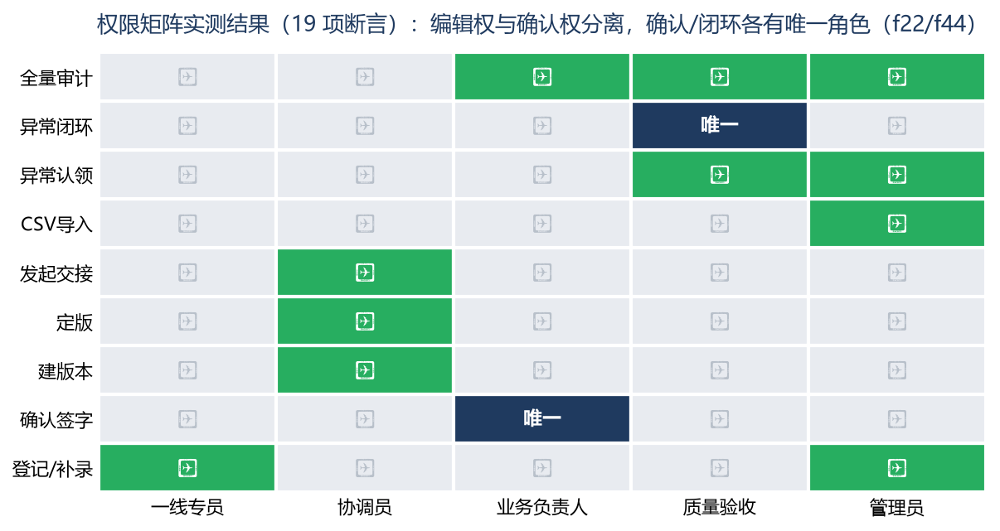

# 权限场景测试 · 会议活动服务需求汇总系统 MVP

| 资料编号 | f24015105-TST-P-01 |
|---|---|
| 版本 | v1.0 |
| 编制日期 | 2026-11-06 |
| 场景 | 权限场景（五角色 × 9 操作矩阵） |
| 断言 | 19 项，通过 19 项，失败 0 项 |

---

## 一、场景说明

权限场景对五角色（一线专员/协调员/业务负责人/质量验收/管理员）× 九类关键操作做矩阵式验证，核心是两条红线：**编辑权与确认权分离（f22：模型/系统无审批权，确认签字仅业务负责人）**、**异常闭环权唯一（f44：仅质量验收）**。



## 二、测试过程（4 组验证）

| 组 | 验证 | 用例 | 结果 |
|---|---|---|---|
| P1 | 确认签字唯一性 | 五角色逐一尝试确认签字 | 一线/协调/管理员/质量 403，业务负责人 200（唯一） |
| P2 | 登记权 | 业务负责人/质量登记 → 拒；一线/管理员登记 → 通过 | "只审不录"分离成立 |
| P3 | 定版/交接/导入/审计 | 一线建版本 403、业务负责人交接 403、一线导入 403、一线全量审计 403、质量看审计 200 | 操作权按矩阵收敛 |
| P4 | 异常队列三级权 | 一线认领 403、质量认领 200、协调闭环 403、质量闭环 200（唯一） | 提出权（多角色）/认领权（qa+admin）/闭环权（仅 qa）三级分离 |

## 三、真实执行日志（执行器输出摘录）

```
── 权限 P1：编辑权/确认权分离（f22）──
[PASS] 一线确认签字 → 403
[PASS] 协调员确认签字 → 403
[PASS] 管理员确认签字 → 403
[PASS] 质量验收确认签字 → 403
[PASS] 业务负责人确认签字 → 200（唯一）
── 权限 P3：定版/交接/导入/审计 ──
[PASS] 一线建版本 → 403
[PASS] 业务负责人发起交接 → 403
[PASS] 一线查全量审计 → 403（仅本人）
[PASS] 质量验收查审计 → 200
── 权限 P4：异常队列三级权 ──
[PASS] 协调员闭环 → 403
[PASS] 质量验收闭环 → 200（唯一）
```

## 四、结果与结论

**19/19 全部通过。** 权限矩阵中每一个"唯一"格（确认签字、异常闭环）都经过其余四角色的逐一反证，不存在隐性越权路径。越权响应统一为 403 + 中文角色说明（如"角色 一线专员 无权执行此操作"），便于一线理解而非暴露技术细节。结论：**编辑权/确认权分离与 f44"不得默认通过"在权限层完整落地**，满足验收口径中"确认状态只能由有权角色写入"的要求。
