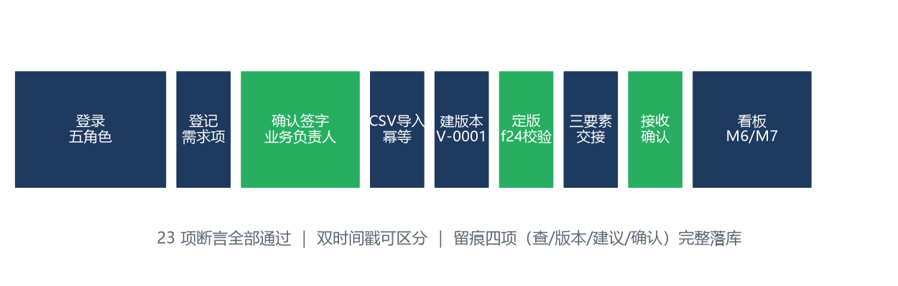

# 正常场景测试 · 会议活动服务需求汇总系统 MVP

| 资料编号 | f24015105-TST-N-01 |
|---|---|
| 版本 | v1.0 |
| 编制日期 | 2026-11-06 |
| 场景 | 正常场景（端到端业务链路） |
| 断言 | 23 项，通过 23 项，失败 0 项 |

---

## 一、场景说明

正常场景验证 MVP 的**主业务链路**在标准输入下的完整可用性：五角色登录 → 一线登记（双时间戳落库）→ 业务负责人确认签字 → 管理员 CSV 导入（幂等）→ 协调员建版本定版（f24 双条件）→ 三要素交接 + 接收确认 → 看板 M6/M7 出数 → 审计留痕四项可回查。该链路对应《技术架构选型》Walking Skeleton D1–D5 的全部交付目标。



## 二、测试过程（8 步）

| 步骤 | 操作 | 执行角色 | 验证点 |
|---|---|---|---|
| 1 | 五角色依次登录 | lin/tang/guml/fujing/qinrui | 返回 200 且携带正确角色 |
| 2 | 登记需求项 | 一线 lin | 状态初始化 unconfirmed；业务发生时间 ≠ 系统接收时间 |
| 3 | 确认签字 | 业务负责人 guml | 确认成功；一线先试确认被 403 拒绝（交叉验证） |
| 4 | CSV 导入两次 | 管理员 qinrui | 首次新建 2 项；重复导入幂等跳过（编号映射 f30） |
| 5 | 确认 10 项 → 建版本 → 定版 | guml + tang | 版本号系统生成 V-0001；f24 双条件通过 |
| 6 | 发起交接 → 接收确认 | tang → lin | 三要素通过；版本内 10 项转已交接 |
| 7 | 看板出数 | 任意角色 | M6 分母 50；双时间戳 53/53 全部可区分 |
| 8 | 审计回查 | 质量验收 fujing | 留痕含 view/suggest/confirm/finalize/handover/import |

## 三、真实执行日志（执行器输出摘录）

```
── 步骤 2：一线登记需求项（双时间戳落库）──
[PASS] 登记返回 200 ｜ 51
[PASS] 状态初始化为 unconfirmed
[PASS] 双时间戳分开记录 ｜ biz=2026-11-05 09:30:00 recv=2026-11-06 02:49:40
── 步骤 5：确认 10 项 → 建版本 → 定版 ──
[PASS] 版本号系统生成 V-0001 ｜ {'version_id': 1, 'version_no': 'V-0001', 'status': 'draft'}
[PASS] f24 双条件满足 → 定版成功
── 步骤 6：三要素交接 + 接收确认 ──
[PASS] 三要素齐全 → 交接成功 ｜ {'handover_id': 1, 'version_no': 'V-0001', 'open_items_count': 43, 'handed_items': 10}
[PASS] 版本内 10 项转为已交接 ｜ 10
── 步骤 7：看板 M6/M7 出数 ──
[PASS] M6 分母=50 ｜ {'numerator': 11, 'denominator': 50, 'rate': 22.0}
[PASS] M7 有来源记录占比>90% ｜ 98.1%
[PASS] 双时间戳全部可区分 ｜ 53/53
── 步骤 8：审计留痕四项可回查 ──
[PASS] 留痕含 view/suggest/confirm/finalize/handover/import
[PASS] 确认动作带 confirmed_by
```

## 四、结果与结论

**23/23 全部通过。** 主链路每一环都有可复核的数据证据：M6 确认完整率 22.0%（11/50，与已确认+已交接项数吻合）、M7 可追溯率 98.1%、双时间戳 100% 可区分、留痕四项完整。链路级结论：**MVP 达到 Walking Skeleton 第一周验收判据**。

**过程发现并修复的缺陷**：定版步骤曾出现请求挂起，定位为 `threading.Lock` 不可重入导致的死锁（持锁期间调用变更写入），改用 `RLock` 后回归通过（缺陷 D1，详见测试方案第五章）。
